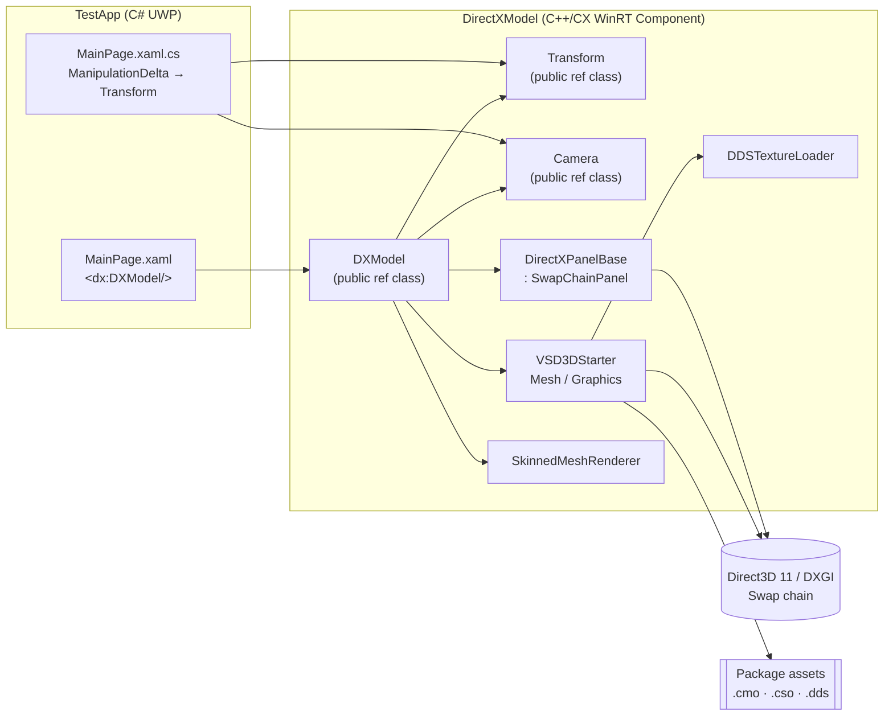
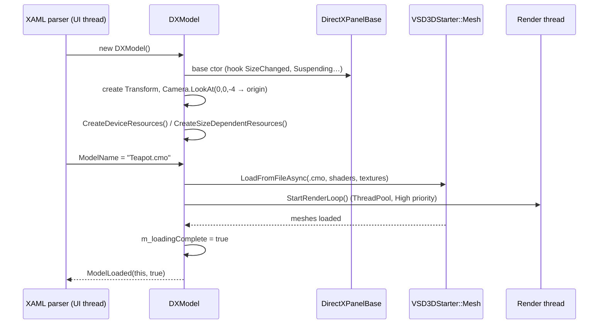
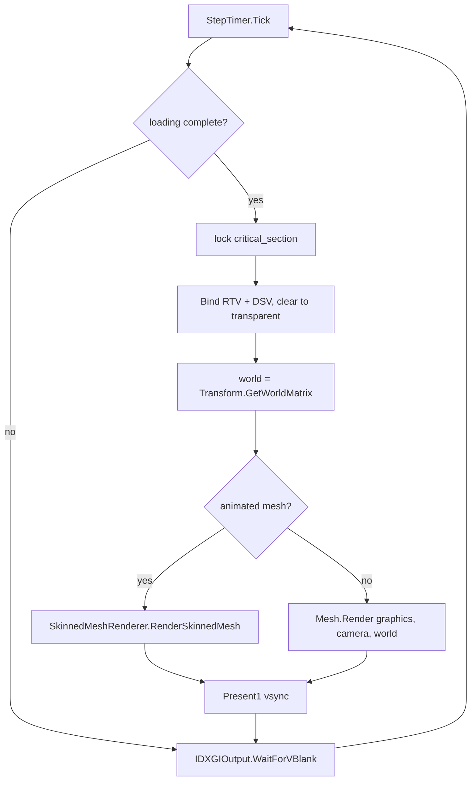
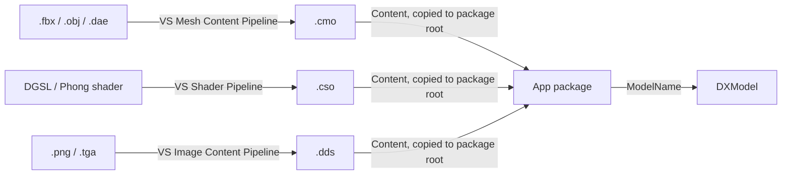

# XAML3D – Solution Architecture

## 1. Purpose

XAML3D provides a reusable **UWP XAML control (`DXModel`)** that renders a 3D model with **Direct3D 11**. Developers can host it in any XAML layout and control it from managed code. They don't need to write DirectX code themselves.

## 2. High-level view



The solution (`XAML3D.sln`) contains two projects:

| Project | Type | Role |
|---|---|---|
| `DirectXModel` | C++/CX Windows Runtime Component (DLL, toolset v141) | The reusable 3D control and its public API. |
| `TestApp` | C# UWP application | Sample host app that shows how to use the control. |

## 3. Layered design

```
┌──────────────────────────────────────────────────────────────┐
│  Presentation (XAML / C#)          TestApp                   │
├──────────────────────────────────────────────────────────────┤
│  Public WinRT API                  DXModel · Transform · Camera│
├──────────────────────────────────────────────────────────────┤
│  Rendering surface                 DirectXPanelBase          │
│                                    (SwapChainPanel, device,  │
│                                     swap chain, lifecycle)   │
├──────────────────────────────────────────────────────────────┤
│  Content & rendering helpers       VSD3DStarter (Mesh,       │
│                                    Graphics), Animation,     │
│                                    DDSTextureLoader,         │
│                                    StepTimer, DirectXHelper  │
├──────────────────────────────────────────────────────────────┤
│  Platform                          Direct3D 11.1 · DXGI 1.3  │
└──────────────────────────────────────────────────────────────┘
```

### 3.1 Public WinRT API

| Type | File | Responsibility |
|---|---|---|
| `DXModel` | [DirectXModel/DXModel.h](DirectXModel/DXModel.h) | XAML element. Exposes `ModelName`, `Transform`, `Camera`, `Clear()`, and the `ModelLoaded` event. Owns the meshes, the render loop, and the size-dependent targets. |
| `Transform` | [DirectXModel/Transform.h](DirectXModel/Transform.h) | Stores `Translation`, `Rotation` (degrees), and `Scale`. Builds the world matrix `S · Rx · Ry · Rz · T`. |
| `Camera` | [DirectXModel/Camera.h](DirectXModel/Camera.h) | Stores an orthonormal basis (Right/Up/Look) and position. Builds a left-handed view matrix and a perspective projection. |

WinRT `public` members are projected to C#. `internal` members, such as `GetWorldMatrix()`, `View()`, and `Proj()`, are visible only to native code in the component.

### 3.2 Rendering surface – `DirectXPanelBase`

[DirectXModel/Common/DirectXPanelBase.h](DirectXModel/Common/DirectXPanelBase.h) adapts Microsoft's SwapChainPanel interop sample. It is a template method base class:

| Hook | Default behaviour | Overridden by `DXModel` to |
|---|---|---|
| `CreateDeviceIndependentResources()` | no-op | – |
| `CreateDeviceResources()` | Create the D3D11 device and context. Try hardware first, then fall back to WARP. | Cache the DXGI output for vblank, initialize `Graphics`, and set the no-cull rasterizer state. |
| `CreateSizeDependentResources()` | Create or resize the composition swap chain, bind it to the panel, and apply the inverse DPI scale. | Create the RTV, DSV, and viewport. Update the camera lens and lighting. |
| `Render()` | no-op | Draw all meshes, then call `Present()`. |
| `Present()` | `Present1(1,0)` with device-lost detection | – |

Lifecycle events handled by the base class:

- `SizeChanged` and `CompositionScaleChanged` call `CreateSizeDependentResources()`.
- `Application.Suspending` calls `IDXGIDevice3::Trim()`.
- When a device is removed or reset, `OnDeviceLost()` recreates all device and size-dependent resources.

### 3.3 Content and rendering helpers

| Component | Origin | Role |
|---|---|---|
| `VSD3DStarter.h` | Visual Studio 3D Starter Kit | Parses `.cmo` into `Mesh` objects (sub-meshes, materials, vertex and index buffers, bones, animation clips). The `Graphics` class manages shared constant buffers (material, light, object, misc). |
| `Animation/Animation.h` | Visual Studio 3D Starter Kit | `SkinnedMeshRenderer`: evaluates keyframes, combines the bone hierarchy, and draws with `SkinningVertexShader`. |
| `DirectXTex/DDSTextureLoader` | DirectXTex | Loads `.dds` textures that materials reference. |
| `Common/StepTimer.h` | DirectX app template | Frame timing and frame count. |
| `Common/DirectXHelper.h` | DirectX app template | `ThrowIfFailed`, `ReadDataAsync`, and SDK layer checks. |

> `Common/Camera.*` and `Common/Model.*` are earlier native versions that the `.vcxproj` doesn't compile. They are kept only for reference.

## 4. Runtime flow

### 4.1 Startup and model loading



### 4.2 Render loop (per frame)



### 4.3 Interaction (TestApp)

1. The user drags a `DXModel`, which raises `ManipulationDelta`.
2. `MainPage.OnManipulationDelta` adds up the X/Y delta.
3. It sets `Transform.Rotation = (x, y, 0)`, interpreted as degrees, and moves the panel's `TranslateTransform`.
4. The render thread reads the new `Transform` on the next frame.

## 5. Threading and synchronization

| Thread | Work |
|---|---|
| UI (ASTA) | XAML events, property setters, size and scale changes, and binding the swap chain to the panel through `ISwapChainPanelNative::SetSwapChain` with the dispatcher. |
| Thread pool (high priority, time-sliced) | Render loop: `Tick → Render → Present → WaitForVBlank`. |
| PPL task continuations | Asynchronous loading of `.cmo`, shaders, and textures. |

A `concurrency::critical_section` (`m_criticalSection`) in `DirectXPanelBase` serializes access to D3D resources. The lock is held during rendering, resizing, scale changes, suspending, and construction. `OnUnloaded` cancels the render loop.

## 6. Graphics pipeline configuration

| Setting | Value |
|---|---|
| Feature levels | 11.1 → 9.1 (WARP fallback) |
| Swap chain | Composition, `B8G8R8A8_UNORM`, 2 buffers, `FLIP_SEQUENTIAL`, premultiplied alpha, max frame latency 1 |
| Depth | `D24_UNORM_S8_UINT` |
| Rasterizer | `CULL_NONE`, multisample and antialiased lines enabled |
| Projection | 70° vertical FOV, near 1, far 1000, left-handed |
| Lighting | 1 directional light toward `(5, 5, -2.5)` (normalized), ambient 0.3, diffuse 0.8, specular intensity 2 |
| Constant-buffer slots | b0 Material · b1 Light · b2 Object · b3 Misc · b4 Bones (skinning) |

## 7. Asset pipeline



The `.cmo` file stores material shader and texture names. At runtime, `Mesh::LoadFromFileAsync` resolves those names relative to the package root, or to optional shader and texture path prefixes.

## 8. Extension points

- **New public features** (materials, textures, lights): add WinRT properties to `DXModel`. Then update `m_lightConstants` and `m_graphics.Update*Constants()` in `CreateSizeDependentResources` or `Render`.
- **Animation**: `LoadAsync` already accepts `IsAnimated`. Exposing that flag and calling `UpdateAnimation(m_timer.GetElapsedSeconds())` in the render loop would turn skinning on.
- **Custom rendering**: derive another control from `DirectXPanelBase` and override the three resource hooks and `Render()`.

## 9. Known limitations

- Only the `.cmo` format is supported.
- Each `DXModel` instance creates its own D3D device and render thread. Many instances on one page multiply GPU and CPU cost.
- `DXModel` has no public way to enable animation yet.
- `ModelLoaded` may fire on a non-UI thread.
